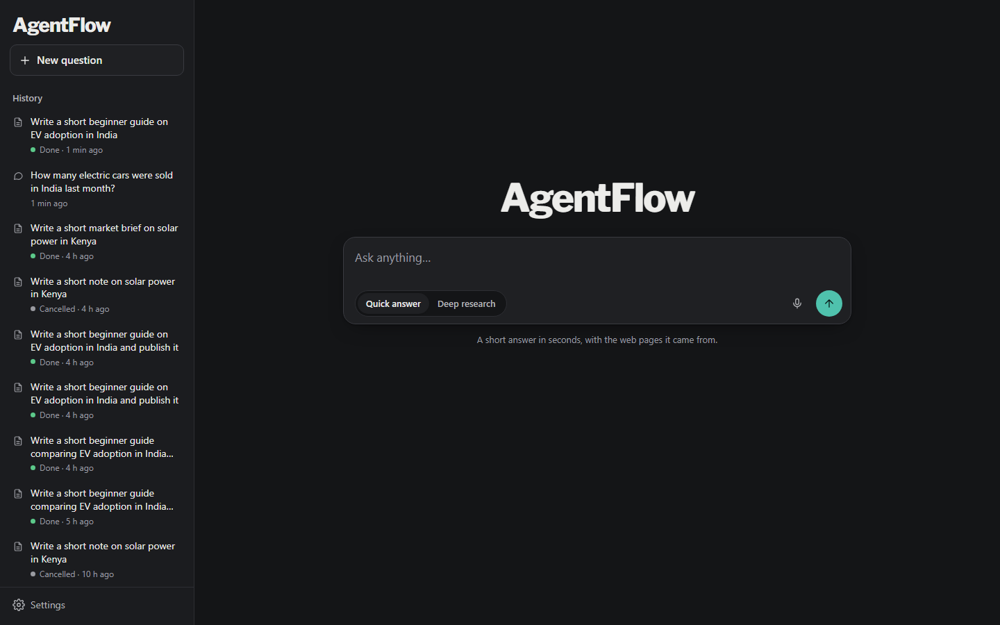
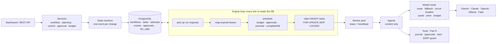

# AgentFlow

[](https://github.com/ghosttech07/AgentFlow/actions/workflows/ci.yml)

**A self-hosted engine for trustworthy AI workflows.** You give it a goal; a team of AI agents plans
the work, researches the live web, analyses, writes and reviews it. Code, not the AI, controls
everything that matters: the order of steps, retries, crash recovery, cost limits and which actions
need a human's approval. Every step is stored in PostgreSQL, so **you can kill the server in the
middle of a run, restart it, and it carries on exactly where it stopped without redoing finished work.**



> **Rule of the codebase: AI decides content, code decides control.** Agents only produce text.
> Plans are validated by code, every status change goes through one state machine, and every side
> effect is idempotent.

---

## Contents
[What it does](#what-it-does) · [Try it in 5 minutes](#try-it-in-5-minutes) ·
[The crash demo](#the-headline-demo-crash-restart-resume) · [Architecture](#architecture) ·
[Key trade-offs](#key-design-decisions-and-trade-offs) · [Reliability](#how-failures-are-handled) ·
[Tests](#tests) · [Limitations](#limitations-and-whats-not-done-yet) · [Roadmap](#roadmap) ·
[API](#api) · [Configuration](#configuration)

## What it does

| Capability | How |
|---|---|
| **Planning and delegation** | A planner agent turns the goal into a graph of tasks (researcher, analyst, writer, reviewer, publisher). Code checks the plan (valid keys, known agents, no cycles) and sends errors back for repair; an invalid plan never reaches the database. |
| **Dependency-aware, parallel execution** | A scheduler runs each task once everything it depends on is done; independent tasks run in parallel on a bounded worker pool. |
| **Persistent state, retries, recovery** | Workflows, tasks, attempts and events live in PostgreSQL. Failed calls retry with exponential backoff and jitter. Workers hold leases with heartbeats; after a crash, the restart reclaims the orphaned task and continues. |
| **Pause, resume, cancel** | Graceful or immediate pause, resume, cancel and retry, from the API or the dashboard, all recorded with who did it and why. |
| **Human approval checkpoints** | Sensitive steps (publishing, and in Part 9 any outside action such as email) wait for an explicit approval. The approver sees exactly what will happen and can edit it first. |
| **Live, cited research** | The researcher searches the web, reads the pages and cites every finding as `[n]`; code removes any source it did not actually read. |
| **Any AI provider, with cost control** | Gemini, Anthropic Claude, OpenAI or a free local model through Ollama, with automatic fallback, a price for every call, budgets that pause (not fail) a workflow, and daily quotas that survive restarts. |
| **Answer-engine dashboard** | Ask a quick question (cited answer in seconds) or start deep research, watch each step, approve, and reopen anything from the history. |

### Where the answers come from (the "brain")
AgentFlow contains no AI model itself. Whoever runs the server connects one in `.env` or
`config/models.yaml`: an API key for **Gemini, Claude or OpenAI**, and/or **Ollama** running locally
(free, private, offline). People using the dashboard never type an AI key. A demo mode
(`LLM_PROVIDER=fake`) runs everything with canned answers, with no key and no cost.

## Try it in 5 minutes

You need Python 3.11+ (3.12 recommended) and Docker Desktop. No API key is needed for the demo.

**Windows (PowerShell)**
```powershell
git clone https://github.com/ghosttech07/AgentFlow.git; cd AgentFlow
Copy-Item .env.example .env
docker compose up -d                       # PostgreSQL 16 (wait until `docker compose ps` says healthy)
py -3.12 -m venv .venv; .\.venv\Scripts\Activate.ps1
pip install -r requirements.txt
alembic upgrade head
python scripts/setup_sample_data.py        # read-only sample database for the SQL tool (fake numbers)
$env:LLM_PROVIDER = "fake"                 # demo mode: canned answers, no AI calls
uvicorn app.main:app
```

**macOS / Linux**
```bash
git clone https://github.com/ghosttech07/AgentFlow.git && cd AgentFlow
cp .env.example .env
docker compose up -d
python3 -m venv .venv && source .venv/bin/activate
pip install -r requirements.txt
alembic upgrade head
python scripts/setup_sample_data.py
LLM_PROVIDER=fake uvicorn app.main:app
```

**Or run everything in Docker** (no Python needed): `docker compose --profile full up -d --build`, then open
http://localhost:8000/dashboard (demo mode; put keys in `.env` and `LLM_PROVIDER=gemini` for real models).

Open **http://127.0.0.1:8000/dashboard**. Ask a question, or switch to **Deep research** and give it a
goal. The API docs are at `/docs`.

**Use a real model:** put `GEMINI_API_KEY=...` in `.env` (free key at Google AI Studio) and start without
`LLM_PROVIDER=fake`. For free local models, install [Ollama](https://ollama.com), run
`ollama pull llama3.2:3b`, and copy a profile from [config/models.example.yaml](config/models.example.yaml)
to `config/models.yaml`.

## The headline demo: crash, restart, resume

```bash
python scripts/crash_demo.py --fake        # add nothing else; drop --fake to use Gemini
```
It starts its own server, runs a multi-agent workflow, and **kills the process (`os._exit`) while the
writer agent is working**. While the server is down it reads the database directly: the research and
analysis tasks are `SUCCEEDED`, the writer is still `RUNNING` with a lease from a dead process. It then
restarts the server, which logs `engine.recovered`, reclaims the writer and finishes the workflow.
The script checks and prints **PASS** only if:
- the tasks that finished before the crash ran exactly **once** (nothing was redone), and
- the writer shows attempt 1 = `worker_lost` and attempt 2 = `succeeded`.

It ends by printing the timeline built from the database. Other demos:

| Command | Shows |
|---|---|
| `python scripts/tools_demo.py` | **Safe actions.** Research (web tools) and the sample database run in parallel; an invented source is removed by code; the email waits for approval and is sent with an edited subject; the server is killed right after sending; after the restart there is still **exactly one** email. Then a prompt-injection page is flagged and its email to the attacker is blocked. |
| `python scripts/demo.py` | Runs every demo below and prints one PASS/FAIL table. |
| `python scripts/controls_demo.py` | Pause and resume; approve a publish step with an edited title (published exactly once); reject and skip a step; cancel while tasks run. |
| `python scripts/budget_demo.py` | A workflow hits `max_llm_calls`, pauses, the budget is raised, it resumes and completes. |
| `python scripts/run_workflow.py "<goal>"` | Runs any goal against a running server with a live progress table. |

Each demo starts its own server on port 8765; stop any other AgentFlow server on the same database first.

## Architecture



A request to result, in short:
1. `POST /workflows {goal, run: true}` stores the workflow and returns at once (202).
2. The engine plans it in the background. The planner's plan is validated by code (`app/core/dag.py`).
3. Every tick the scheduler promotes tasks whose dependencies are done, pauses for budgets, requests
   approvals and completes or fails the workflow, each step in its own short transaction.
4. Workers claim ready tasks with a lease and run the agent; no database transaction is open while
   the model thinks. The result is saved only if this worker still owns the task.

More detail, including the state diagrams for workflows and tasks: [docs/ARCHITECTURE.md](docs/ARCHITECTURE.md).

## Key design decisions and trade-offs

| Decision | Why | What it costs |
|---|---|---|
| **PostgreSQL is the queue and the source of truth** (`SKIP LOCKED` claims, no Redis/Kafka) | One system to run; every state change and its event commit together, so recovery is just "read the database". | Throughput is bounded by one database (fine for AI workflows, where each step takes seconds; not built for thousands of tasks per second). |
| **The engine polls every second** and is woken early by local events | Simple and robust: nothing depends on in-memory state, which is what makes crash recovery trivial. | Up to ~1 s of scheduling latency; cross-process wake-ups (LISTEN/NOTIFY) are planned for Part 14. |
| **At-least-once task execution + idempotent side effects** (not "exactly-once" AI calls) | A crash can happen after the model answered but before the result was saved, so a step may run again. Anything with an outside effect (publish, email, files) is keyed so a repeat is harmless. | A crashed step may pay for one extra model call. |
| **Leases + heartbeats + fenced saves** (status, lease owner and attempt number must match) | A slow "zombie" worker can never overwrite a newer attempt or a cancelled task. | A little more bookkeeping on every save. |
| **Single-node recovery by default** (`ENGINE_SINGLE_NODE=true`): on startup every RUNNING task is an orphan | Instant recovery for the common one-process deployment. | Two single-node engines on the same database would steal each other's work; multi-node mode waits for lease expiry instead. |
| **The AI proposes, code validates** (plans, tool calls, citations) | Wrong or malicious model output becomes a clear error or a human decision, never an unchecked action. | Extra repair round-trips when a model ignores the rules (bounded: 2 plan repairs). |
| **Budgets pause instead of failing** | Hitting a cost limit is a human decision ("is it worth more?"), and finished work is kept. | A paused workflow needs a person to act. |
| **Structured JSON "action protocol" for tools** instead of each provider's native function calling | One loop works the same on Gemini, Claude, OpenAI, Ollama and the fake model, and every call goes through the same router, budget and journal. | Slightly more prompt text; native function calling is listed as future work. |
| **One process runs the API and the engine** | Easy to run and demo. | Scaling out the workers separately is Part 14. |

## Tools and safe actions

With `config/tools.yaml` (copy [config/tools.example.yaml](config/tools.example.yaml)) agents use tools; without
it they behave exactly as before. The model **proposes** a tool call as structured JSON; **code** checks the
tool is allowed for that agent, validates the arguments, decides whether a human must approve, runs it with a
timeout, and journals it.

| Agent | Tools |
|---|---|
| researcher | `web_search` (Tavily if you have a key, else free metasearch), `web_fetch` |
| analyst | `sql_query` (read-only, external data only; a sample database with fake numbers is included), `calculator` |
| writer | `file_write` (a private workspace per workflow) |
| communicator | `send_email` (outbox file by default, or SMTP), `webhook_post` (e.g. Slack) |

Safety, all enforced in code:
- **Side-effect classes.** Every tool is `none`, `internal_write`, `external_read` or `external_write`; outside
  writes need approval by default, and the approver sees (and can edit) exactly what will be sent.
- **Crash-safe journal.** Each call is recorded before and after it runs with an idempotency key. After a crash
  the agent resumes from the journal, so an email that went out is never sent again.
- **Taint tracking.** Once a task has read web content, every outside action needs a human, even if the config
  says "never"; this flows to downstream tasks. Suspicious text ("ignore previous instructions", hidden text)
  is flagged on the approval card.
- **Source verification.** The researcher can only cite pages it actually opened; anything else is removed.
- **SSRF guard.** Fetches only reach public addresses (every redirect re-checked), with size and type limits.
- **Read-only SQL.** One SELECT only (parsed), a read-only database role, a read-only transaction and a timeout.
- **Secrets.** API credentials are referenced by name and never stored in the journal or logs.

## Adaptive workflows

A plan can change shape while it runs, but always inside limits that code sets and checks.
The AI can suggest a change. Code decides whether it happens. Nothing that already finished is ever undone.

### Conditions

`run_if`, a loop's `until` and `best_by`, and `replan_if` are short expressions over task outputs.
Code evaluates them with an AST whitelist; they are never passed to `eval`:

```text
review_guide.output.approved and review_guide.output.score >= 8
research_china.output.confidence == 'low' or len(research_china.output.gaps) > 3
```

- **Names** are task keys. Each name has `.output` (that task's output) and `.status`.
- **Allowed syntax:** `and` / `or` / `not`, the comparisons, `+ - * / // % **`, indexing, lists, and the functions
  `len lower upper min max abs round any all`.
- **Limits:** 300 characters, 80 nodes, depth 12, exponent 64. A string or list built inside a condition can hold
  at most 10,000 items.
- **When a condition is checked:**
  - A syntax error or an unknown key is rejected when the plan is made.
  - A missing field at run time is recorded as `condition_error`. It never crashes the engine.
  - `run_if` may only use the task's own dependencies.
  - A loop's conditions may only use that loop's own tasks.

### Branches and joins

- A task whose `run_if` is false is `SKIPPED` with `skip_reason: condition_false`.
- A task's `join` controls when it runs:
  - `all_succeeded` (the default): every dependency must succeed.
  - `any_succeeded`: one successful dependency is enough.
  - `all_done`: the task runs once every dependency has finished, successfully or not.
- **A branch may fail without failing the workflow** when every task that depends on it uses a tolerant join.
  The workflow still COMPLETES, but:
  - `result.failed_branches` lists the failed branches;
  - a `workflow.completed_with_failed_branches` event is recorded;
  - the dashboard shows a warning badge.

### Feedback loops

```json
"loops": [{"name": "improve_draft", "body": ["write_guide", "review_guide"],
           "until": "review_guide.output.approved and review_guide.output.score >= 8",
           "max_iterations": 3, "on_exhausted": "continue_with_best",
           "feedback": {"from": "review_guide", "to": "write_guide"}}]
```

Loops are **unrolled, never cycles**. When `until` is false, code inserts the next iteration as new tasks
(`write_guide__v2`, `review_guide__v2`):

- The writer gets the reviewer's issues as `revision_feedback` and must list its `changes_made`.
- Tasks downstream of the loop wait until the loop has decided.
- Everything stays a DAG, so the Part 5 guarantees still hold: leases, retries, crash recovery, and "finished work
  is never redone".

**What bounds a loop:**
- `max_iterations`, capped at `MAX_LOOP_ITERATIONS` (default 5).
- The budget field `max_iterations_total`.
- A pre-check that refuses an iteration whose expected LLM calls would cross `max_llm_calls`.
- Loop body task keys of at most 46 characters, so the `__vN` suffix always fits.
- Body tasks may not have a `run_if`.

**When the loop runs out** (`on_exhausted`):
- `continue_with_best` uses the best finished iteration by `best_by` (default: the reviewer's score).
- `fail` fails the workflow.
- `ask_human` asks for a workflow-level approval, which can grant extra iterations.

If `best_by` can't be evaluated, the latest finished iteration is used, and the event records why. A loop whose
current iteration can never finish (for example, a body step skipped by an approver) ends the same way rather
than hanging.

### Re-planning

A running workflow can get a **PlanPatch**, which adds tasks, cancels tasks that never started, and rewires the
dependents of a failed task to its replacement.

**What starts a re-plan:**
- **A task failure**, only if the workflow opted in with `replan_on_failure` (planner-made plans; off by default).
- **A succeeded task's `replan_if`** being true.
- **A human**, with `POST /workflows/{id}/replan`. This works on every workflow.
- **A human patch** sent with `POST /workflows/{id}/plan-patch` while the workflow is PAUSED.

The workflow goes to `REPLANNING` and the planner proposes a patch. Code then validates the merged graph.

**What a patch may never do:**
- cancel finished, running or approved work;
- rewire a dependent that already started;
- cancel a task that belongs to a loop.

**When a human must approve the patch:** it adds a sensitive step, it adds more than
`REPLAN_AUTO_APPROVE_MAX_TASKS` tasks (default 2), or it replaces a sensitive task. Otherwise it is applied
automatically.

**How a patch is applied:**
- In one locked transaction.
- Replaced tasks become `SUPERSEDED`, and each version is kept in `plan_versions` (`GET /workflows/{id}/plan-versions`).
- At most `MAX_REPLANS` re-plans per workflow (default 2, or the budget's `max_replans`).
- A plan_patch approval expires like any other approval, even while the workflow is REPLANNING.
- A crash during re-planning is recovered: the request is re-run.

### Memory between workflows

After a workflow finishes, three kinds of memory are kept:

| Kind | What it holds | Kept for |
|---|---|---|
| Fact | A finding from a researcher whose sources were verified | 30 days |
| Lesson | What first drafts missed, learned from a loop | 180 days |
| Artifact summary | A short summary of what the workflow produced | 180 days |

Later tasks in the same `memory.namespace` get the most relevant memories as a PRIOR KNOWLEDGE section:

- **Ranking:** Postgres full-text search, then relevance × recency × confidence. Pinned memories come first.
- **Answering from memory:** a researcher can answer from memory (`from_memory`) and skip the web.
- **Managing memories:** `GET /memories` (search), `POST /memories/{id}/pin`, `DELETE /memories/{id}` and
  `POST /memories/purge-expired`.

**Memory poisoning is contained:**
- A memory remembers whether its source was tainted (it read untrusted web content) or private (it saw SQL
  rows). Lessons and summaries inherit both flags from the tasks they came from.
- A tainted memory is shown inside `<untrusted ...>` tags, and the task that reads it becomes tainted too.
  Tainted tasks need approval before any external write.

### Exfiltration through reads

A task that holds private data can't leak it by fetching a URL that carries that data. When it reads a URL that
is not trusted, the call is held for a human. A URL counts as trusted only if it:

- came from a search result,
- came from a fetched page,
- came from the task input or an *untainted* upstream task,
- or is on the read allowlist.

`http_request` GET with a body is treated as a write.

**Demo:** `python scripts/adaptive_demo.py` runs 12 checks offline with the fake model:

1. A loop where the first draft scores 5 and the second scores 9.
2. Conditional branches.
3. A re-plan after a permanent failure.
4. A crash while the second draft is being written, with no duplicate iteration after the restart.
5. A second run that answers from memory with fewer calls.
6. An exfiltration attempt that is held for a human.

## Users, teams, roles and policies

Each person gets their own key. Each key belongs to one team and has one role. Rules about who must approve what
are written in a file and checked by code.

### Getting started

1. Set `ADMIN_API_KEY` (the bootstrap / break-glass key).
2. Create teams and users with it:

```bash
curl -X POST localhost:8000/admin/teams -H "X-API-Key: $ADMIN" -d '{"name": "research"}'
curl -X POST localhost:8000/admin/users -H "X-API-Key: $ADMIN" \
     -d '{"name": "ann", "role": "approver", "team": "research"}'   # returns ann's api_key ONCE
```

- **Keys are stored safely.** Only a sha256 of each key is stored, and keys are never logged.
- **Managing keys:** `POST /admin/users/{id}/rotate-key` replaces a key, and `POST /admin/users/{id}/disable`
  turns a user off. Either one makes the old key stop working at once.
- **Checking a key:** `GET /me` shows who a key belongs to. The dashboard shows it under Settings.

### Roles

The roles are ordered; each one can do everything the roles above it can.

| Role | Can |
|---|---|
| viewer | Read their team's workflows, approvals, timeline and memory |
| operator | Also create, start, pause, resume, cancel, retry, re-plan and change budgets |
| approver | Also approve or reject |
| admin | Also manage users. With no team, an admin sees every team. |

### Teams are kept apart

- A user only sees their own team's workflows, approvals, events and memories.
- Another team's object answers **404**, so its existence is not revealed.
- Memory is stored under the team's own namespace, and Quick Ask history is per team.
- The actor recorded on every action is the signed-in user, whatever the request body says.

### Backward compatible

- **No `ADMIN_API_KEY` and no users:** everything is open, as before.
- **`ADMIN_API_KEY` but no users:** reads are open and controls need the key, as before.
- **Once a user exists:** a key is needed for all workflow, approval and memory endpoints.

### Policies (`config/policies.yaml`, see `config/policies.example.yaml`)

```yaml
rules:
  - name: publish_needs_two_approvers
    when: {agent_type: publisher}
    approvals: 2                # N DIFFERENT people
    approver_role: approver
  - name: email_outside_the_company
    when: {tool: send_email, recipient_not_in_domains: [example.com]}
    require_approval: true
  - name: marketing_cannot_call_webhooks
    when: {tool: webhook_post, team: marketing}
    deny: true                  # the call is refused and the agent is told why
```

- **How a rule matches:** every key in `when` must match. The keys are `agent_type`, `task_key` (glob), `tool`,
  `team`, `side_effect` and `recipient_not_in_domains`.
- **When several rules match,** the strictest wins.
- **Tool rules and task rules are separate.** A rule with a `tool`, `side_effect` or recipient condition applies to
  single tool calls. Any other rule applies to whole tasks. `deny` needs a tool condition.
- **An approver's edits are checked again.** Edited tool arguments go through the policy again, so an approver who
  changes the recipient to an outside address triggers the stricter rule.
- **The file is checked at startup.** A bad file stops the app. `GET /admin/policies` lists the rules and the
  safety floor.

**How multi-approver approvals work:**

- **Every approver counts.** Each person's yes is recorded as a vote (`votes`, event `approval.vote_recorded`).
  The step runs only after `approvals` different people have said yes.
- **An edit restarts the vote.** If an approver edits the content, earlier votes are cleared, so everyone approves
  exactly what will run.
- **One no is enough.** A single rejection by an eligible approver rejects.

### Safety floor (code; no policy, role or API call can turn it off)

1. A sensitive agent (publisher) always needs an approval.
2. An outside write from a tainted task always needs an approval.
3. Policies can only *add* requirements. `require_approval: false` is refused when the file is loaded.
4. Only approvers and admins can approve. A lower `approver_role` is raised to approver.
5. When 2 or more approvers are needed:
   - each person votes once;
   - the admin key counts as one person;
   - the person who created the workflow can't vote (four eyes).
6. One rejection rejects.

**Demo:** `python scripts/governance_demo.py`. It runs offline and covers 12 checks: teams and users, isolation,
roles, two approvers, four eyes, and the safety floor. Afterwards it removes its own users, so the other demos
keep running without keys.

## How failures are handled

| Failure | What happens |
|---|---|
| Timeout, rate limit (per minute), 5xx, overloaded model | Retried with exponential backoff and full jitter; `retry-after` is respected. |
| Model overloaded, out of quota, or not found | The router tries the next `provider:model` in that agent's route (circuit breaker per model). |
| Bad API key, refusal, permanent error, rejected approval | Not retried; the task fails with a clear `error_type`. |
| Invalid model output | One automatic repair request with the exact validation error; then the retry policy. |
| Process crash or killed worker | Restart reclaims RUNNING tasks as `worker_lost` and retries them; finished tasks are never re-run; interrupted planning is re-planned. |
| Worker stops heartbeating | Its lease expires, the reaper reclaims the task, and the old worker's late result is discarded. |
| Budget reached | The workflow pauses (in-flight steps finish, nothing new starts) until a human raises the limit. |
| Repeat of a side effect after a crash | The publisher (and in Part 9 email, webhooks and files) is idempotent: it happens once. |

For testing this on purpose, `POST /dev/chaos` (development only) can crash the process, raise
transient, overloaded or permanent errors, or hang a chosen task.

## Tests

```bash
pytest                       # 550+ tests on a real Postgres test database; fake AI, no network, no cost
pytest -m live_ollama -s     # free: real local model through Ollama
pytest -m live_gemini -s     # one small real Gemini call (live_anthropic / live_openai with keys)
```
The suite rebuilds its schema from the Alembic migrations (downgrade, then upgrade) and fails if the
models drift from them. Failure-path tests cover crashes mid-task and mid-planning, two engines racing
on one database, lease loss, retries and backoff, overloaded and out-of-quota providers, budget pauses,
rejected and expired approvals, cancellation while running, malicious URLs (SSRF), SQL that tries to
write, and duplicate side effects after a crash.

## Limitations and what's not done yet

Honest status as of 2026-11-26:
- **Small local models and tools.** Measured with `scripts/local_model_check.py`: `llama3.2:3b` never called a
  tool (it answers straight away), `qwen3:4b` uses tools but is too slow (110-170 s per run, timeouts),
  `qwen3.5:4b` researched and analysed correctly with tools (35-120 s; few runs so far). The recommended
  routing in `config/models.example.yaml` keeps planning, writing and sending on Gemini.
- **The prompt-injection detector is a heuristic.** It flags, it does not block; the real protection is that
  tainted tasks cannot act outside without a human.
- **OpenAI's strict structured-output mode may reject the free-form `arguments` object** of the tool protocol
  (Gemini and Ollama accept it); not tested live (no OpenAI key).
- **No code-execution tool** and no native function calling (both future work).
- **Keys are API keys** (no SSO / OIDC login yet). Cross-team totals (`/metrics/summary`, `/engine/status`) are
  for global admins only.
- **Free web search is best-effort.** Without a Tavily key the researcher uses free metasearch, which
  can be throttled or return thin results. Gemini's own Google Search grounding needs billing.
- **Small local models are weak at planning and writing.** `llama3.2:3b` researches well enough but
  writes poorly and sometimes makes invalid plans; route the planner and writer to a stronger model.
- **The Anthropic and OpenAI adapters are unit-tested only** (no keys were available for live tests).
- **Free Gemini quota is small** (about 20 requests a day on the main model).
- **Scale is not load-tested.** Designed for one process; running several engines needs
  `ENGINE_SINGLE_NODE=false`, and a load test is Part 14.
- **Adaptive features are bounded on purpose:** at most 5 loop iterations and 2 re-plans per workflow by default.
  Memory search is keyword full-text, with no embeddings yet. There is no code-execution tool.
- **Voice input** is shown in the dashboard but not built yet.
- **CI runs on GitHub** (secret scan, ruff, the full test suite on Postgres 16); the Docker image is for demos and single-machine use, not a hardened production image.

## Roadmap

| Part | Status |
|---|---|
| 1-7: foundation, agents, planning, execution engine, reliability, human controls, observability | Done |
| 8: multi-provider AI and cost control | Done |
| 9: tools and safe actions (web, HTTP APIs, SQL, files, email, webhooks; crash-safe journal, approvals, taint tracking) | Done |
| 10: adaptive workflows (feedback loops, conditional branches, bounded re-planning, memory) | Done |
| 11: policy engine, users and roles, team isolation, multiple approvers | Done |
| 12: tamper-evident audit trail, reproducibility, PII redaction | Planned |
| 13: quality engine (evals, quality gates, replay) | Planned |
| 14: real-time updates and scale (SSE, LISTEN/NOTIFY, multiple workers, load test) | Planned |
| 15: developer experience (YAML templates, Python SDK, plugins) | Planned |

## API

| Method | Path | Purpose |
|---|---|---|
| POST | `/ask` | Quick answer: `{question}` → live-web answer with `[n]` citations (saved to history) |
| GET | `/history`, `/asks/{id}` | Questions and research, newest first; one saved answer |
| POST | `/workflows` | Create; `run: true` plans and runs it in the background (202). Optional `budget` |
| GET | `/workflows`, `/workflows/{id}` | List; detail with tasks, progress, approvals, allowed controls, budget usage |
| POST | `/workflows/{id}/pause` · `/resume` · `/cancel` · `/retry` 🔑 | Human controls |
| PATCH | `/workflows/{id}/budget` 🔑 | Change budget limits, then resume |
| GET | `/workflows/{id}/timeline` · `/events` · `/graph` · `/result` | Readable timeline, raw events, task graph (Mermaid), final result |
| GET | `/workflows/{id}/tasks/{key}` · `/attempts` | Task detail and attempt history |
| GET/POST | `/approvals` · `/approvals/{id}/approve` 🔑 · `/reject` 🔑 | Approval queue and decisions |
| POST | `/plans/preview` | Plan a goal without storing anything |
| GET | `/agents` · `/tools` · `/providers` · `/metrics/summary` · `/engine/status` | Catalogs, provider health, cost and latency |
| GET | `/dashboard` | The web app |

🔑 needs the `X-API-Key` header when `ADMIN_API_KEY` is set (always set it in production). Errors always
look like `{"error": {"code": "...", "message": "..."}}`.

## Configuration

The most used settings (`.env`; the full list with comments is in [.env.example](.env.example)):

| Setting | Default | Notes |
|---|---|---|
| `LLM_PROVIDER` | `gemini` | `fake` = demo mode with canned answers |
| `GEMINI_API_KEY`, `ANTHROPIC_API_KEY`, `OPENAI_API_KEY` | – | A provider without a key is skipped |
| `OLLAMA_BASE_URL` | `http://localhost:11434/v1` | Local models, used when Ollama is running |
| `MODELS_CONFIG_PATH` | `config/models.yaml` | Routes per agent role, quotas ([example](config/models.example.yaml)) |
| `TOOLS_CONFIG_PATH` | `config/tools.yaml` | Tools per agent, allowlists, approvals ([example](config/tools.example.yaml)); no file = no tools |
| `POLICIES_CONFIG_PATH` | `config/policies.yaml` | Approval / deny rules ([example](config/policies.example.yaml)); no file = only the safety floor |
| `DEFAULT_MAX_LLM_CALLS` | 50 | Default budget safety net per workflow |
| `ENGINE_MAX_CONCURRENCY`, `TASK_TIMEOUT_SECONDS` | 4, 180 | Worker pool size, per-task limit |
| `ADMIN_API_KEY` | – | Admin password for control actions; required in production |
| `TAVILY_API_KEY` | – | Optional, more reliable web search (free tier) |

## Project layout

```
app/
  agents/    planner + researcher, analyst, writer, reviewer, publisher
  engine/    engine loop, scheduler, worker, retry, recovery, chaos (dev)
  llm/       model router, providers (Gemini, Anthropic, OpenAI, Ollama, fake), pricing, quotas
  tools/     Part 9: tool framework, SSRF guard, journal, tool loop, the tools
  services/  workflows, planning, controls, approvals, budgets, history, timeline
  core/      state machine, DAG rules, events, errors
  api/       REST routes      models/  SQLAlchemy      schemas/  Pydantic
  static/    dashboard.html (no build step)
alembic/     migrations        config/  models, pricing and tools examples
scripts/     crash, controls and budget demos; sample data setup; model listing
tests/       550+ tests incl. failure paths; live tests behind markers
```

Detailed design notes for contributors: [CLAUDE.md](CLAUDE.md) and [docs/ARCHITECTURE.md](docs/ARCHITECTURE.md).

**Stack:** Python 3.12 · FastAPI · SQLAlchemy 2 (async) + asyncpg · PostgreSQL 16 · Alembic · Pydantic v2 · pytest.
